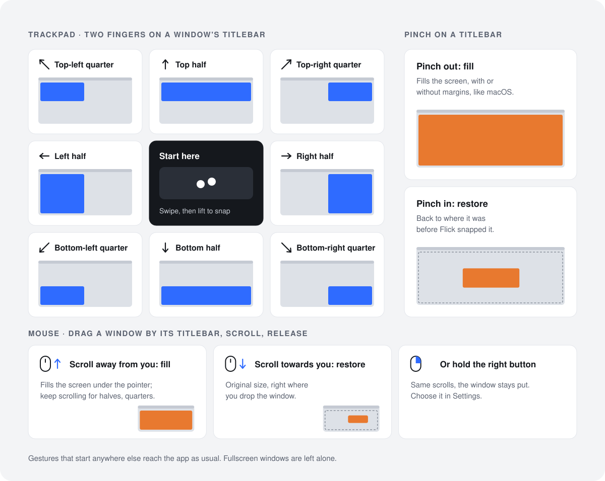

<h1 align="center">
  <picture>
    <source media="(prefers-color-scheme: dark)" srcset="docs/logo/flick-logo-dark.svg">
    
  </picture>
</h1>

  Snap macOS windows with two fingers on the titlebar, or with a mouse by dragging and scrolling. 
  Free, open source, and it lives in your menu bar.

  <a href="https://github.com/BergCyrill/Flick/releases/latest"><b>Download the latest release</b></a>

## What it does

- **Swipe** with two fingers on a window's titlebar to snap it to a half or a quarter of the
  screen.
- **Pinch** out to fill the screen, pinch in to put the window back where it was.
- **With a mouse**, drag a window by its titlebar and scroll: away from you fills, keep scrolling
  for the halves and quarters; towards you restores.
- A **live preview** shows where the window will go before you let go.
- Everything else stays as it was: gestures that start anywhere but a titlebar reach the app,
  and fullscreen windows are left alone.

## Install

You need macOS 14 or later and a trackpad or a mouse.

1. Download `Flick-<version>.dmg` from the
   [latest release](https://github.com/BergCyrill/Flick/releases/latest), open it and drag
   *Flick* onto *Applications*.
2. Open Flick. The first time, macOS blocks it, because Flick is signed with its own certificate
   rather than one bought from Apple. Open **System Settings → Privacy & Security**, scroll to
   the message about Flick and click **Open Anyway**.
3. Grant Flick **Accessibility** access when it asks. It needs that to move windows.

Flick has no Dock icon; it shows up in the menu bar.

## Use

Put the pointer on a window's titlebar (the top 40 pt, toolbars included):

| Trackpad, two fingers | Result |
|---|---|
| swipe ← → ↑ ↓ | left, right, top or bottom half |
| swipe ↖ ↗ ↙ ↘ | the matching quarter |
| pinch out | fill the screen |
| pinch in | restore the size and place from before the first snap |

| Mouse, while dragging a titlebar | Result |
|---|---|
| scroll away from you | fill the screen under the pointer |
| keep scrolling away | left half, right half, the four quarters, top half, bottom half |
| scroll towards you | restore the original size, where you drop it |

The window moves when you lift your fingers or release the button. Scrolling back steps back
through the slots; swipe or scroll back to where you started to cancel. Like macOS's own tiling,
windows go edge to edge unless *Tiled windows have margins* is on in **System Settings → Desktop
& Dock**.

## Settings

Open **Settings…** (⌘,) from Flick's menu-bar icon to:

- turn swiping, pinching and the live preview on or off;
- choose which mouse button scroll-to-fill uses: the left one while dragging, the right one held
  on a titlebar (the window stays put), both, or none;
- turn off scrolling on past fill to the halves and quarters;
- start Flick at login;
- choose whether and how often Flick checks for updates.

*Pause gestures* in the menu turns Flick off without quitting it.

## Updates

Flick checks GitHub for a new version once a day; you can change that in Settings. When there is
one, a blue dot appears on its menu-bar icon and a notification tells you once. Nothing is
downloaded until you choose *Update to …* in the menu. Updating keeps the Accessibility
permission and needs no *Open Anyway*.

## Privacy

Flick uses Accessibility to find the window under the pointer and move it. It watches scroll,
trackpad-gesture and mouse-button events to recognise its gestures, never the keyboard, and
doesn't record or store them. Its only network access is the update check, which downloads a small file from GitHub.

## Uninstall

Quit Flick from its menu, move it from *Applications* to the Trash, and remove it from **System
Settings → Privacy & Security → Accessibility** (and from Login Items if you turned that on).

---

Flick is [MIT licensed](LICENSE). To build it yourself or contribute, see
[CONTRIBUTING.md](CONTRIBUTING.md); maintainers, see [docs/releasing.md](docs/releasing.md).
