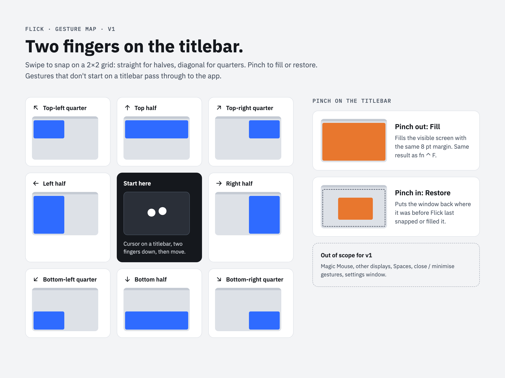

<h1 align="center">
  <picture>
    <source media="(prefers-color-scheme: dark)" srcset="docs/logo/flick-logo-dark.svg">
    
  </picture>
</h1>

Two-finger trackpad gestures on a window's titlebar that snap macOS windows: swipe for halves
and quarters, pinch out to fill, pinch in to restore. A free, minimal take on
[Swish](https://highlyopinionated.co/swish/).



## Installing

1. Download `Flick-<version>.dmg` from the
   [latest release](https://github.com/BergCyrill/Flick/releases/latest), open it and drag
   *Flick* onto *Applications*.
2. Open Flick. macOS blocks it the first time because it is signed with Flick's own
   certificate, not one from Apple: open **System Settings → Privacy & Security**, scroll to
   the message about Flick and click **Open Anyway**.
3. Grant Flick **Accessibility** access when it asks.

A new version downloaded this way needs *Open Anyway* once more; the Accessibility permission
stays.

## Getting started

Prerequisites: macOS 14 or later, Xcode (provides Swift 6, `swift format` and `sourcekit-lsp`),
Nix with flakes enabled, and [direnv](https://direnv.net/).

```sh
direnv allow          # or: nix develop
pre-commit install    # once per clone
task test             # unit tests
task lint             # swiftlint + swift format, strict
task format           # rewrite sources with swift format
task run              # build, bundle to build/Flick.app, (re)launch
```

On first launch Flick asks for Accessibility access. Enable it under **System Settings →
Privacy & Security → Accessibility**; Flick picks it up within a few seconds. `task bundle`
signs with the *Flick Code Signing* certificate when the keychain has it (see *Code signing*),
so the permission survives rebuilds. Without it the build is signed ad-hoc and says so; after
each rebuild remove Flick from that list, run `task run` again and re-enable it.

**Upgrading from a build before the bundle ID change** (`local.personal.flick` →
`io.github.bergcyrill.flick`): settings carry over on first launch, but macOS sees a new app.
Grant the new *Flick* Accessibility access and turn *Launch at login* on again in Flick's
settings. The old *Flick* entry in *Accessibility* grants nothing any more; remove it whenever
convenient.

## Project layout

```text
Sources/FlickCore/       pure logic: geometry, layout, gesture recognition (unit-tested)
Sources/Flick/           macOS adapters: event tap, Accessibility, overlay, menu-bar app
Tests/FlickCoreTests/    swift-testing suites for FlickCore
support/Info.plist       app bundle metadata used by `task bundle`
docs/design/             design drivers (gesture map, live preview)
docs/logo/               logo lockups (light/dark), mark, social preview
docs/superpowers/        spec and implementation plan
```

## Code signing

Builds are signed with a self-signed certificate, *Flick Code Signing*. macOS ties the
Accessibility permission to Flick's bundle ID and this certificate, so the permission survives
rebuilds and updates. The maintainer creates the certificate once:

```sh
scripts/make-signing-cert.sh    # imports it into the login keychain, writes ~/flick-signing
```

It prints the next steps: keep the `.p12` and its password in the password manager, set the
GitHub secrets `SIGNING_CERT_P12` and `SIGNING_CERT_PASSWORD`, delete `~/flick-signing`.
Never create a second certificate: a new one changes the designated requirement, and every
user has to grant Accessibility again. To sign on another Mac, double-click the `.p12` from the
password manager.

## Releases

Every merge to `main` that brings a `feat`, `fix` or breaking commit publishes a release:
`.github/workflows/release.yml` runs `task release`, which tests, lints, builds, signs, checks
the signature and publishes `Flick-<version>.dmg` with release notes on GitHub Releases. The
version follows the commits since the last tag (git-cliff, `cliff.toml`): `fix` → patch,
`feat` → minor, breaking → minor below 1.0 and major from 1.0. Merges with only `docs`,
`chore`, `ci`, `build`, `test`, `refactor` or `style` commits release nothing. With squash
merges the PR title is the commit, so it must be a Conventional Commit too.

```sh
task release-notes      # what the next release would say (empty: nothing to release)
task release DRY=1      # the whole release locally, without publishing
```

Pull requests run `task test`, `task lint` and `task build`, and — for branches of this
repository — `task release DRY=1` with the signing certificate (`.github/workflows/ci.yml`).

## Usage

Put the pointer on a window's titlebar (the top 40 pt, toolbars included), then:

| Gesture (two fingers) | Result |
|---|---|
| swipe ← / → | left / right half |
| swipe ↑ / ↓ | top / bottom half |
| swipe ↖ ↗ ↙ ↘ | matching quarter |
| pinch out | fill the screen (8 pt margin) |
| pinch in | restore the frame from before the first snap |

A blue preview shows the target while your fingers move. The window moves when you lift them.
Swipe back to where you started to cancel. Gestures that start anywhere else go to the app as
usual. *Pause gestures* in the menu-bar item turns Flick off without quitting.

With a mouse (or a trackpad, keeping the click held), drag a window by its titlebar and scroll
while still holding the button:

| While dragging | Result |
|---|---|
| scroll away from you | fill the screen under the pointer |
| scroll towards you | restore the size from before the first snap, under the pointer |

The preview follows the pointer; the window changes when you release the button. Scroll back to
cancel.

With *Right button* (or *Both*) chosen under *Scroll to fill and restore* in Settings, hold the
mouse's right button on a titlebar instead and scroll: the window stays where it is and fills or
restores when you let go. A right-click without scrolling still opens the app's menu, on release.
This works with a mouse only, not with a trackpad's two-finger click.

*Settings…* (⌘,) in the menu-bar item turns each gesture and the live preview on or off, chooses
the button for scroll to fill and restore, and starts Flick at login. A gesture that is off
swallows nothing: its scrolls and pinches reach the app. Changes apply from the next gesture.

## Manual test checklist

Run after changes to `Sources/Flick/`, with `task run`, on the built-in trackpad and, if
available, a Magic Trackpad:

- [ ] Finder, Safari, Terminal, VS Code: each of the 8 swipe directions snaps to the right slot with 8 pt gaps.
- [ ] The preview appears after a short swipe, follows direction changes, and disappears on lift.
- [ ] Swiping back to the start before lifting leaves the window where it was.
- [ ] Pinch out fills; pinch in afterwards restores the previous frame; a second pinch in does nothing.
- [ ] Snap ←, then →, then pinch out, then pinch in: the window returns to its size and position from before the first snap.
- [ ] Scrolling inside a window, a Safari tab strip below the titlebar zone, and the desktop behaves normally.
- [ ] Pinch-to-zoom inside Safari and Preview still zooms.
- [ ] In a fullscreen app (e.g. Safari or Terminal), scrolling and pinch-zooming near the top edge behave normally and Flick shows no preview.
- [ ] With natural scrolling switched off (System Settings → Trackpad), ↖ still snaps top-left.
- [ ] *Pause gestures* stops all snapping; unpausing brings it back.
- [ ] Remove Flick from Accessibility while running: the menu shows "Waiting for Accessibility access" after a relaunch.
- [ ] Second display (if available): snapping uses the display under the pointer.
- [ ] Settings: with *Swipe on titlebar to snap* off, a titlebar swipe scrolls the app (e.g. Safari's tab strip) and pinch still works; the same the other way round for *Pinch on titlebar*.
- [ ] Settings: with *Show live preview* off, no overlay appears and windows still move on lift.
- [ ] Settings survive a relaunch (`task run`).
- [ ] First launch after the bundle ID change: settings changed before it are still set.
- [ ] Rebuild after a code change (`task run`): Accessibility stays granted, no prompt.
- [ ] The menu's first line shows *Flick &lt;version&gt;*; the settings window's footer shows *Version &lt;version&gt; (&lt;build&gt;)* without scrolling.
- [ ] *Pause gestures* while the settings window is open shows the paused note; unpausing hides it.
- [ ] *Launch at login* on: Flick appears in System Settings → General → Login Items and starts after logging out and in; off removes it. If macOS wants approval, the hint says so and *Open Login Items…* opens the pane.
- [ ] Mouse wheel: drag a Finder, Safari, Terminal and VS Code window by its titlebar and scroll away: fill preview; release: the window fills and stays filled.
- [ ] Scroll towards you while dragging a window Flick snapped: original-size preview under the pointer that follows it; release: original size where you let go, fully on screen.
- [ ] Scroll away and back before releasing: no preview, the window stays where you dropped it.
- [ ] Natural scrolling off: same directions as with it on.
- [ ] Trackpad: click-hold a titlebar and scroll with two other fingers: same behaviour.
- [ ] Holding the button in a text area and scrolling (extending a selection) scrolls the app as usual.
- [ ] Second display: drag a window onto it and scroll away: it fills that display.
- [ ] With *Scroll to fill and restore* set to *Off* or *Right button*, scrolling during a left drag reaches the app.
- [ ] After updating from a build with the *Scroll while dragging* switch: the picker shows *Left button* if the switch was on, *Off* if it was off; the choice survives a relaunch.
- [ ] *Right button*: hold right on a Finder, Safari, Terminal and VS Code titlebar and scroll away: fill preview; release: the window fills and stays filled. Towards you on a window Flick snapped: restores to its frame from before the first snap.
- [ ] *Right button*: a plain right-click on a titlebar or toolbar (Finder *Customize Toolbar…*, a Safari tab, VS Code's title bar) opens the menu once, on release, also after holding the button for a second; choosing an item works.
- [ ] *Right button*: hold, scroll away and back, release: no menu, nothing moves.
- [ ] Right-clicks in window contents, on the desktop and in the Dock behave as usual with every picker value.
- [ ] *Left button* and *Off*: holding right and scrolling on a titlebar opens the menu on press as usual and scrolls nothing special.
- [ ] Fullscreen window: right-click and right-hold + scroll near the top edge behave as usual.
- [ ] Trackpad, *Right button*: a plain two-finger click on a titlebar opens the menu as usual.
- [ ] Release DMG: opening it shows *Flick* and an *Applications* link; after dragging and *Open Anyway*, the menu shows the release's version.
