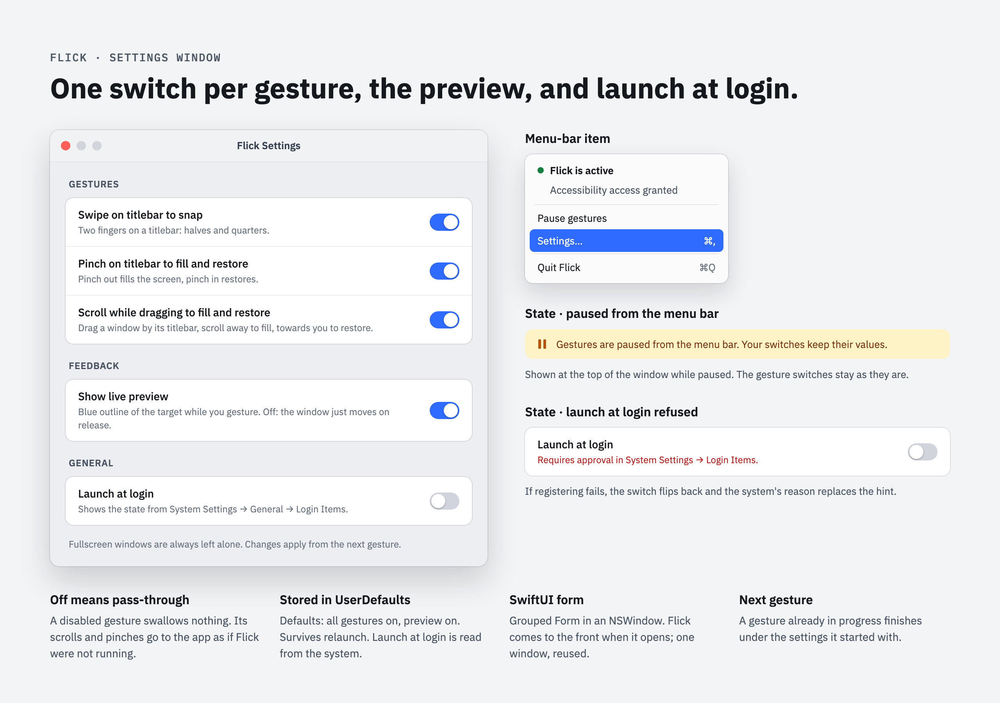
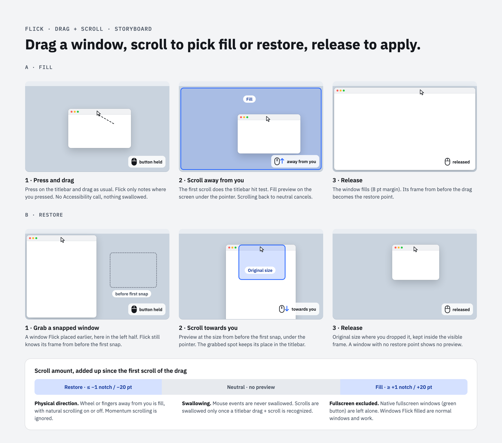

# Flick settings window and drag + scroll — design

- **Date:** 2026-10-14
- **Status:** approved
- **Builds on:** [Flick v1 design](2026-10-14-flick-v1-design.md)
- **Design drawing:** [Flick design canvas](https://claude.ai/artifact/8NszVx1Eqce2uHPLTWRneV)
  (boards *Settings window* and *Drag + scroll*)

## Design drivers

These drawings define the expected behaviour and look. If code and drawing disagree, the
drawing wins until it is updated.

| Settings window | Drag + scroll |
|---|---|
|  |  |

The editable source is the design canvas linked above; the PNGs in `docs/design/` are renders
of it.

## Goal

1. **Drag + scroll:** while dragging a window by its titlebar with the mouse button held,
   scrolling away from you fills the screen and scrolling towards you restores the window. A
   preview shows the target; the window moves when the button is released.
2. **Settings window:** turn each gesture on or off, turn the live preview off, and launch Flick
   at login.

Success means: with a mouse wheel and with a trackpad, drag + scroll fills and restores windows
in Finder, Safari, Terminal and VS Code; every switch in the settings window takes effect from
the next gesture and survives a relaunch.

## Delivery

One spec, two PRs, in this order:

1. **Settings window** (`feature/no-ref/settings-window`): `FlickSettings`, the settings store,
   the window, the menu entry, gating of the existing swipe and pinch gestures and of the
   preview, launch at login. This spec and the two drawings land with it.
2. **Drag + scroll** (`feature/no-ref/drag-scroll`): the new recognizer, the new input events,
   restore under the pointer, and the *Scroll while dragging* switch.

## Scope

### In this iteration

- **Drag + scroll**, see the *Drag + scroll* board:
  - Applies while the **left mouse button is held** after a press inside the titlebar zone (top
    40 pt) of a standard window. Works with a mouse wheel and with trackpad scrolling.
  - Scroll amounts are added up from the first scroll of the drag, in **physical direction**
    (same with natural scrolling on or off) and counted positive away from you: away from you
    is fill, towards you is restore.
    - Mouse wheel (no precise deltas): fill at ≥ +1 line, restore at ≤ −1 line.
    - Trackpad (precise deltas): fill at ≥ +20 pt, restore at ≤ −20 pt.
    - In between: no target, no preview. Scrolling back into this neutral zone cancels.
  - **Preview** while dragging (if the preview is on); applied on **release**.
  - **Fill** uses the screen under the pointer at release. The frame the window had when the
    button was pressed counts as its current frame for the restore history, so a window Flick
    snapped and you then dragged out still restores to the frame from before the first snap.
  - **Restore** puts the window at its restore size (the frame from before the first snap of
    the run) **under the pointer**: the point you grabbed keeps its relative horizontal position
    in the titlebar and its distance from the window's top edge, and the result is moved
    inside the visible frame of the screen under the pointer. No preview and nothing on release
    if Flick has no restore frame for that window.
  - The preview follows the pointer while you keep dragging.
- **Settings window**, see the *Settings window* board:
  - *Swipe on titlebar to snap*, *Pinch on titlebar to fill and restore*, *Scroll while dragging
    to fill and restore*, *Show live preview*, *Launch at login*.
  - Opened from the menu-bar item: *Settings…* (⌘,) between *Pause gestures* and *Quit Flick*.
  - While paused, a note at the top says gestures are paused from the menu bar; the switches
    keep their values.
- **Fullscreen windows** (native fullscreen, `AXFullScreen`) stay excluded from every gesture,
  drag + scroll included. Windows Flick filled are normal windows; all gestures work on them.

### Not in this iteration

Gap size setting, threshold settings, per-app exclusions, keyboard shortcuts, drag + scroll for
snapping to halves or quarters, restoring a window just by dragging it out of a slot (without
scrolling), Magic Mouse gestures, a stable signing identity.

## Approach

### Drag + scroll input

The existing session event tap also listens to `leftMouseDown`, `leftMouseDragged` and
`leftMouseUp`. These are **listen-only**: Flick never swallows a mouse event.

- **Mouse down** only records the press point. No Accessibility call happens per click: a hit
  test there would add latency to every click on the system.
- **The first scroll while the button is held** does the work once per drag:
  1. `TitlebarProbe.window(atTitlebar:)` at the current pointer location. While a window is
     dragged its titlebar stays under the pointer.
  2. `WindowAccess.frame(of:)` gives the current frame. The frame at press time is that frame
     shifted back by the pointer movement since the press (a dragged window moves with the
     pointer). Restore under the pointer and the restore history use it.
  - If either step fails, the drag is **not claimed**: its scrolls all pass through, with no
    retry until the next press.
  - **Accepted limitation:** Flick doesn't check that the window actually moved with the
    pointer. Holding the button for some other drag (a text selection, say), ending up over a
    titlebar and scrolling there counts as drag + scroll. Telling them apart would need an
    Accessibility lookup after every click.
- **Claimed drag:** every scroll event until release is swallowed, including the first one.
  Momentum scrolling (after a trackpad flick) is ignored and passes through.
- **Release** commits the current target, or cancels if there is none.

"Button held" is decided by the adapter from `CGEventSource.buttonState(.combinedSessionState,
button: .left)` when it translates a scroll event, so a lost mouse-up can't leave Flick thinking the button is still down.

Rejected: Accessibility "window moved" notifications (late and app-dependent, so not good enough
for a live preview); resizing the window during the drag (the system keeps moving the window
under the pointer and the window would jump).

### Settings

Settings live in `UserDefaults` under the bundle id `local.personal.flick`. Defaults: all three
gestures on, preview on. *Launch at login* isn't stored by Flick: the switch reads
`SMAppService.mainApp.status` and calls `register()` / `unregister()`.

**Off means pass-through:** a disabled gesture claims nothing, so its events reach the app as if
Flick weren't running. *Pause gestures* still turns everything off at once and isn't persisted
(unchanged from v1).

Each recognizer reads the settings when a gesture **begins**; a gesture already in progress
finishes under the settings it started with.

## Architecture

Additions and changes on top of the v1 architecture. Everything with logic stays in
`FlickCore` and is unit-tested.

### `FlickCore`

- **`FlickSettings`** (new): value type with `swipeToSnap`, `pinchToFillRestore`,
  `scrollWhileDragging`, `livePreview`, all `Bool`, all `true` by default. No persistence.
- **`InputEvent`** (extended) with:
  - `.mouseDown(location:)`, `.mouseDragged(location:)`, `.mouseUp(location:)`, each with a
    `GlobalPoint`
  - `.dragScroll(deltaY: Double, precise: Bool, invertedFromDevice: Bool, location: GlobalPoint)`:
    a scroll event while the left button is held, momentum excluded.
  - The existing cases stay as they are.
- **`DragContext`** (new): `frameAtPress: GlobalRect`, `pressPoint: GlobalPoint`.
  `GestureContext` gains an optional `drag: DragContext?` (default `nil`), and its `pointer` is
  the current pointer for drag updates.
- **`DragScrollRecognizer`** (new, `@MainActor`): state machine for the flow in *Approach*.
  Depends on `TitlebarProbe`, `WindowAccess`, a `settings: () -> FlickSettings` closure and
  `isPaused`. Emits the existing `GestureUpdate` (`.preview` / `.commit` / `.cancel`) and
  returns an `EventDecision` per event.
  - The physical direction uses `DirectionClassifier.fingerDelta`; "away from you" is finger
    movement up (negative `dy`).
  - While a target is set, every `.mouseDragged` emits `.preview` with the updated pointer.
  - A `.mouseDown` while a drag is tracked cancels it (lost mouse-up). `reset()` cancels too.
- **`InputRouter`** (new, `@MainActor`): the single entry point for the event tap. Mouse events
  and `.dragScroll` go to `DragScrollRecognizer`; `.scroll`, `.momentum` and `.magnify` go to
  `GestureRecognizer`. A `.scroll` while a drag is tracked also resets `DragScrollRecognizer`
  (the button was released unseen). `reset()` resets both.
- **`GestureRecognizer`** (changed): takes a `settings: () -> FlickSettings` closure; a swipe
  `began` is claimed only if `swipeToSnap`, a pinch `began` only if `pinchToFillRestore`.
- **`DragRestore`** (new): pure function
  `frame(restoring original: GlobalRect, drag: DragContext, pointer: GlobalPoint, visible: GlobalRect) -> GlobalRect`
  (only the size of `original` is used) implementing restore under the pointer (grab fraction kept, top offset kept and capped to the
  new height, then shifted inside `visible`; a window larger than `visible` aligns to its
  top-left). Results are rounded to whole points.
- **`FlickController`** (changed):
  - Takes a `settings: () -> FlickSettings` closure. With `livePreview` off, `.preview` only
    hides.
  - For drag contexts: `.restore` uses `DragRestore` with the screen under `context.pointer`;
    committing any slot passes `drag.frameAtPress` as the current frame to
    `FrameHistory.recordMove`.
  - Only calls `PreviewPresenter.show` when the frame differs from the one shown, so a preview
    that follows the pointer doesn't redraw for nothing.

### `Flick`

- **`EventTap`** (changed): mask adds `leftMouseDown`, `leftMouseDragged`, `leftMouseUp`. Mouse
  events always return the event. The translator emits `.dragScroll` for a non-momentum scroll
  (precise or not) while `CGEventSource.buttonState` reports the left button down; otherwise it behaves
  as before. Hands everything to `InputRouter`.
- **`PreviewOverlay`** (changed): animates only when the size changes; pure moves (following
  the pointer) are immediate.
- **`SettingsStore`** (new, `ObservableObject`): holds `settings: FlickSettings` (saved to
  `UserDefaults` on every change, read by the closures above), `isPaused` (not persisted) for
  the window's note, and `launchAtLogin` / `loginProblem`, which go through `LoginItem` and are
  re-read from macOS each time the window opens.
- **`LoginItem`** (new): wraps `SMAppService.mainApp`: status, enable, disable. On failure the
  switch flips back and the hint shows the reason; `requiresApproval` shows *Requires approval
  in System Settings → Login Items* and offers to open that pane
  (`SMAppService.openSystemSettingsLoginItems()`).
- **`SettingsWindow`** (new): a SwiftUI grouped `Form` in an `NSWindow` via
  `NSHostingController`, created once and reused. Opening it calls `NSApp.activate()` and
  `makeKeyAndOrderFront`, because an `LSUIElement` app has no Dock icon to bring it forward.
- **`MenuBarApp`** (changed): builds the store, router and both recognizers, adds *Settings…*
  (⌘,), and mirrors *Pause gestures* into `SettingsStore.isPaused`.

### Data flow (drag + scroll, fill)

`leftMouseDown` → `InputRouter` → `DragScrollRecognizer` notes the press → `leftMouseDragged` …
→ wheel → `EventTap` (button held) → `.dragScroll` → `DragScrollRecognizer` (asks
`TitlebarHitTester` and `WindowMover`, claims) → `.preview(context, .slot(.fill))` →
`FlickController` → `PreviewOverlay` … → `leftMouseUp` → `.commit(context, .slot(.fill))` →
`FlickController` → `WindowMover` sets the frame → `FrameHistory.recordMove(from:
frameAtPress, …)` → overlay hides.

## Error handling

- **Tap disabled by the system:** the existing re-enable path calls `InputRouter.reset()`,
  which cancels a drag + scroll in progress and hides the preview.
- **Lost mouse-up:** the next mouse down, or a trackpad scroll without a held button, cancels
  the tracked drag and hides the preview.
- **Hit test or frame read fails or times out** (0.25 s Accessibility limit): the drag isn't
  claimed; no retry until the next press.
- **Release on a window that went away:** the commit finds no frame and does nothing, as for
  the existing gestures.
- **Moving the window right after release:** the commit runs after the mouse-up has passed
  through, so the system's drag has ended. If an app still moves the window afterwards, Flick
  accepts it (no fighting, as in v1). This is the riskiest assumption; see *Testing*.
- **Settings changed mid-gesture:** the gesture finishes under the settings it started with.
- **Launch at login fails** (unsigned or moved bundle, not approved): the switch flips back and
  shows the system's reason.

## Testing

- **`FlickCore`** (swift-testing, `swift test`):
  - `DragScrollRecognizer`: press, scroll, release → commit; thresholds for wheel and trackpad;
    natural and classic scrolling; back to neutral cancels; pointer not on a titlebar → not
    claimed; probe or frame read failing → not claimed and no retry; unclaimed drag swallows
    nothing; momentum not handled; lost mouse-up; `reset()`; disabled setting and pause claim
    nothing; settings read once per drag; preview follows the pointer.
  - `InputRouter`: routing of every `InputEvent` case; a trackpad scroll during a tracked drag
    resets it; `reset()` resets both recognizers.
  - `GestureRecognizer`: swipe and pinch each gated by their own switch.
  - `DragRestore`: grab fraction and top offset kept; clamping on each edge; window larger than
    the visible frame; secondary display with a negative origin.
  - `FlickController`: drag fill records `frameAtPress`; drag restore uses `DragRestore`; preview
    off only hides; no redundant `show` calls.
  - `FlickSettings`: defaults.
- **Manual checklist in the README:** mouse wheel and trackpad, natural scrolling on and off,
  each settings switch, the preview switch, launch at login after logging out and in, dragging
  across two displays, fullscreen windows ignored, and the riskiest assumption: the window keeps
  the filled or restored frame after release in Finder, Safari, Terminal and VS Code.

**Known friction:** like the Accessibility grant, a login item registered from the ad-hoc signed
`build/Flick.app` may need re-approving after a rebuild.
