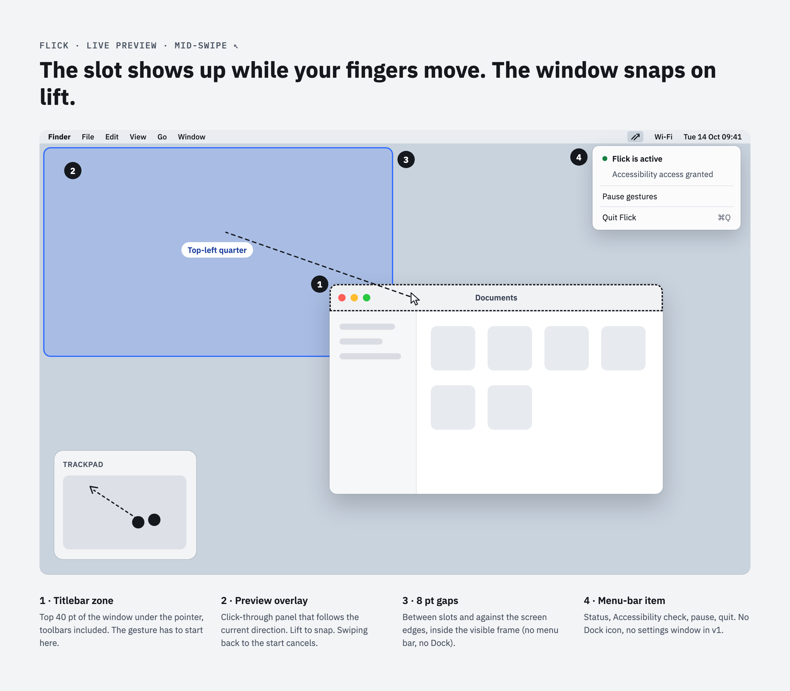

# Flick v1 — design

- **Date:** 2026-10-14
- **Status:** approved
- **Design drawing:** [Flick design canvas](https://claude.ai/artifact/8NszVx1Eqce2uHPLTWRneV) (gesture map, live preview, architecture)

## Design drivers

These drawings define the expected behaviour and look. If code and drawing disagree, the
drawing wins until it is updated.

| Gesture map | Live preview & menu bar |
|---|---|
|  |  |

The editable source is the design canvas linked above; the PNGs in `docs/design/` are renders
of it.

## Goal

Flick is a free, personal replacement for [Swish](https://highlyopinionated.co/swish/), limited
to the two gestures used most:

1. **Swipe to snap:** a two-finger swipe that starts on a window's titlebar snaps that window
   into a slot on a 2×2 grid.
2. **Pinch to fill / restore:** pinching out on a titlebar fills the screen (like
   macOS `fn ⌃ F`), and pinching in restores the frame the window had before the first snap of a run.

Success means: build and install Flick locally, grant Accessibility access once, and both
gestures work reliably in Finder, Safari, Terminal and VS Code on the built-in trackpad and a
Magic Trackpad.

## Scope

### In v1

- 8-direction swipe on the titlebar:

  | Direction | Slot                |
  |-----------|---------------------|
  | ←         | left half           |
  | →         | right half          |
  | ↑         | top half            |
  | ↓         | bottom half         |
  | ↖         | top-left quarter    |
  | ↗         | top-right quarter   |
  | ↙         | bottom-left quarter |
  | ↘         | bottom-right quarter|

- Pinch out on the titlebar → **fill** (visible frame minus gaps).
- Pinch in on the titlebar → **restore** the window's frame from before the first snap of a run.
  A run is a series of snaps while the window stays where Flick put it (within 2 pt); moving or
  resizing it by hand, or restoring, ends the run. Does nothing if Flick has no recorded frame
  for that window.
- **Live preview overlay:** while the gesture is in progress, a translucent rounded rectangle
  shows the target frame. The window moves when the fingers lift. Swiping back to the starting
  point before lifting (below the distance threshold) cancels.
- **8 pt gaps** between slots and against the visible-frame edges. A hardcoded constant in v1.
- **Menu-bar app** (no Dock icon): status line, Accessibility status, *Pause gestures* toggle,
  *Quit Flick* (⌘Q). If Accessibility isn't granted, the menu offers to open the relevant
  System Settings pane.
- The target screen is the one containing the window's titlebar under the pointer. Only its
  **visible frame** is used (excludes menu bar and Dock).

### Not in v1

Magic Mouse, keyboard shortcuts, moving windows across displays, Spaces, close / minimise /
fullscreen gestures, settings window, configurable gaps, launch at login, notarised
distribution, 3×2 / 3×3 grids.

## Approach

Flick reads gesture events from a **public `CGEventTap`**. No private frameworks.

- **Swipe:** two-finger scrolling on a trackpad produces `scrollWheel` events that are
  *continuous* (`kCGScrollWheelEventIsContinuous == 1`). They carry a scroll phase
  (`mayBegin`, `began`, `changed`, `ended`, `cancelled`) and point deltas on both axes. After the
  fingers lift, momentum events follow (`kCGScrollWheelEventMomentumPhase != 0`).
- **Pinch:** trackpad pinches arrive as gesture events. `NSEvent(cgEvent:)` decodes them as
  `.magnify` with a `magnification` delta and a phase.
- **Swallowing:** once Flick has claimed a gesture (it started on a titlebar), the tap returns
  `nil` for that gesture's events and the following momentum events. Apps never see them, so
  Safari's tab strip doesn't scroll and nothing zooms. All other events pass through unchanged.

Rejected alternatives: the private `MultitouchSupport.framework` gives raw finger positions but
is undocumented, can break with macOS updates, and can't swallow events on its own.
`NSEvent.addGlobalMonitorForEvents` can only observe events, not swallow them.

**Riskiest assumption:** that a session-level `CGEventTap` reliably receives and can swallow
magnify gesture events on macOS 26. The first implementation task is a throwaway spike that
logs scroll and gesture events from a tap to confirm this before anything is built on top.

## Architecture

One Swift package, two targets. See the *Architecture* artboard in the design canvas.

### `FlickCore` (library, pure Swift, no AppKit / ApplicationServices imports)

Everything with logic in it. All of it is deterministic and unit-tested.

- **`Geometry`:** `GlobalPoint` and `GlobalRect` value types (named so they don't clash with the MacTypes `Point` / `Rect` that ApplicationServices imports) in a top-left-origin global coordinate
  space (the space CGEvent and Accessibility use). Includes a helper to convert an
  `NSScreen`-style bottom-left-origin rect, given the primary screen height.
- **`Slot`:** `leftHalf`, `rightHalf`, `topHalf`, `bottomHalf`, `topLeft`, `topRight`,
  `bottomLeft`, `bottomRight`, `fill`.
- **`Target`:** what a gesture is aiming at: `.slot(Slot)` or `.restore`.
- **`WindowHandle`:** an opaque `Hashable` handle the adapters hand out for a window. `FlickCore`
  never looks inside it.
- **`DirectionClassifier`:** maps an accumulated finger translation `(dx, dy)` to an optional
  `Slot`. Returns `nil` below a minimum distance (`40 pt`). Otherwise picks one of 8 sectors of
  45° each, centred on the 8 directions.
- **`LayoutEngine`:** `frame(for: Slot, in visibleFrame: GlobalRect, gap: Double) -> GlobalRect`. The gap
  applies against every edge and between neighbouring slots: a half is
  `(visible − 3·gap) / 2` wide, a quarter is that in both dimensions, fill is
  `visible` inset by `gap`. Results are rounded to whole points.
- **`GestureRecognizer`:** a state machine fed with normalised input events (`InputEvent`: a
  scroll phase/momentum/delta, or a magnify phase/delta, plus the pointer location). Steps:
  1. On swipe `began` / magnify `began` it asks a `TitlebarProbe` (protocol,
     `window(atTitlebar: GlobalPoint) -> WindowHandle?`) for the window whose titlebar is under the
     pointer. If none, the gesture is ignored to its end.
  2. If there is one, it claims the gesture for that `WindowHandle`: it returns `.swallow` for every
     event until the gesture ends, plus all momentum events that directly follow it.
  3. It emits `GestureUpdate`s for the claimed window: `.preview(Target?)` while moving (swipes:
     `.slot` from `DirectionClassifier`; pinches: `.slot(.fill)` once cumulative magnification
     is above `+0.15`, `.restore` below `−0.15`, else `nil`), then `.commit(Target)` on `ended`
     with a non-nil target, or `.cancel` on `cancelled` or when the final target is `nil`.
  - Finger direction is normalised: when the event says the scroll direction is inverted
    (natural scrolling), deltas are negated so that "fingers move up-left" always means ↖.
- **`FrameHistory`:** remembers, per `WindowHandle`, the frame to restore (`original`) and where
  Flick last placed the window (`placed`): `recordMove(from:to:for:)` keeps `original` while the
  current frame is within 2 pt of `placed`, otherwise starts a new run; `peek(for:)`, `take(for:)`.
- **`FlickController`:** connects the recogniser's updates to the effects, through protocols:
  `WindowAccess` (read / set a `WindowHandle`'s frame), `ScreenProvider` (visible frame of the
  screen containing a point), `PreviewPresenter` (show rect / hide).
  - On preview: it computes the target rect (`LayoutEngine` for a slot, `FrameHistory` peek for
    restore) and shows it.
  - On commit of a slot: it sets the new frame, reads back where the window actually ended up
    (apps may adjust it, e.g. Terminal's character grid) and calls `FrameHistory.recordMove`.
  - On commit of restore: it takes the stored frame and sets it. Nothing happens if there is
    none.
  - On cancel: it hides the preview.
  - A `paused` flag makes the recogniser claim nothing, so every event passes through.

### `Flick` (executable, the macOS adapters)

Thin wrappers, kept small enough to check by reading and by hand.

- **`EventTap`:** creates the `CGEventTap` (`.cgSessionEventTap`, head insert, mask
  `scrollWheel` + gesture event types) on the main run loop. Converts each `CGEvent` into
  `InputEvent`, hands it to `GestureRecognizer`, and returns `nil` or the event. Re-enables the
  tap if macOS disables it (`tapDisabledByTimeout` / `tapDisabledByUserInput`).
- **`TitlebarHitTester`** (`TitlebarProbe`): uses `AXUIElementCopyElementAtPosition` on the
  system-wide element, walks up to the `AXWindow`, and requires subrole `AXStandardWindow`.
  "On the titlebar" means the pointer is inside the window frame and within its top **40 pt**.
  Windows of Flick's own process are ignored. Returns a `WindowHandle` wrapping the `AXUIElement`
  (hashed and compared with `CFHash` / `CFEqual`).
- **`WindowMover`** (`WindowAccess`): reads `AXPosition` / `AXSize`, sets position, then size,
  then position again (so a window being moved to a smaller screen area isn't clamped by its old
  size).
- **`ScreenAdapter`** (`ScreenProvider`): the `NSScreen` containing the point, its
  `visibleFrame` converted to top-left coordinates.
- **`PreviewOverlay`** (`PreviewPresenter`): one borderless, non-activating, click-through
  `NSPanel` at a level above normal windows, on all Spaces. It draws a rounded rectangle
  (12 pt radius, 2 pt accent border, accent at ~20 % fill) and animates frame changes briefly.
- **`MenuBarApp`:** `NSApplication` with `.accessory` activation policy, `NSStatusItem` with
  the menu from the design. Checks `AXIsProcessTrustedWithOptions` on launch (with the prompt
  option) and only starts the tap once it is trusted. Polls every few seconds until it is.

### Data flow (swipe)

`CGEvent` → `EventTap` → `InputEvent` → `GestureRecognizer` (asks `TitlebarHitTester`, gets a
`WindowHandle`) → `.preview(.slot(s))` → `FlickController` → `LayoutEngine` → `PreviewOverlay` …
fingers lift → `.commit(.slot(s))` → `FlickController` → `WindowMover` sets the frame →
`FrameHistory.recordMove` → overlay hides.

## Error handling

- **No Accessibility permission:** the tap isn't created and the menu shows the state with a
  button to open System Settings. No crash, no event interception.
- **Tap disabled by the system:** it is re-enabled in the callback, and the incident is logged
  via `os.Logger`.
- **AX calls fail** (window closed mid-gesture, app not responding, AX error codes): the
  gesture is cancelled and the overlay hidden. The failure is logged and nothing is retried.
- **Window refuses the size** (minimum size, fixed-size windows): Flick sets the frame once and
  accepts what the app applies. No fighting.
- **Pointer leaves the titlebar mid-gesture:** irrelevant. The decision is made once at `began`.

## Testing

- **`FlickCore`:** unit tests with swift-testing (`import Testing`), run by `swift test`:
  - `DirectionClassifier`: all 8 sectors, boundaries at ±22.5°, below-threshold `nil`.
  - `LayoutEngine`: every slot on a reference visible frame, gap maths, rounding, a non-zero
    origin (secondary display, menu-bar offset).
  - Coordinate conversion between bottom-left and top-left origin.
  - `GestureRecognizer`: scripted event sequences: claimed vs. unclaimed gestures, momentum
    swallowing, natural-scroll inversion, cancel by returning to the start, pinch thresholds.
  - `FrameHistory` and `FlickController` with in-memory fakes of the three protocols.
- **`Flick` adapters:** a manual checklist in the README (each direction, pinch out/in, pause,
  revoked permission) run in Finder, Safari, Terminal and VS Code.

## Tooling and repo

Follows the global repo conventions:

- **Build:** SwiftPM (`Package.swift`, Swift 6 language mode, macOS 14+ deployment target).
  The Apple toolchain comes from the installed Xcode. Nix doesn't provide Swift itself,
  because the nixpkgs Swift lags behind macOS 26.
- **`flake.nix` dev shell:** `go-task`, `swiftlint`, `pre-commit` (`swift format` ships with Xcode). It exports
  nothing that hides Xcode's `swift` / `sourcekit-lsp` from `$PATH`, so the VS Code Swift
  extension finds `sourcekit-lsp`. Inputs are pinned via `flake.lock`. `.envrc` contains
  `use flake`.
- **`Taskfile.yml`:** `test` (`swift test`), `lint` (`swiftlint` + `swift-format lint`),
  `build`, `bundle` (assembles `build/Flick.app` with an `Info.plist` setting `LSUIElement`,
  ad-hoc signed), `run` (bundle, then open it).
- **`.pre-commit-config.yaml`:** standard hygiene hooks plus local `swiftlint` and
  `swift-format lint` hooks.
- **`README.md`:** Getting started (`direnv allow` / `nix develop`, `task test`, `task run`,
  granting Accessibility), project layout, manual test checklist.
- **`.gitignore`:** `.build/`, `build/`, `.swiftpm/`, `.direnv/`, `.env*`, `.DS_Store`.

**Known friction:** an ad-hoc signature changes with every build, and macOS ties the
Accessibility grant to it, so after a rebuild the permission may have to be re-granted. A stable
self-signed signing identity solves this and is a follow-up, not v1.
